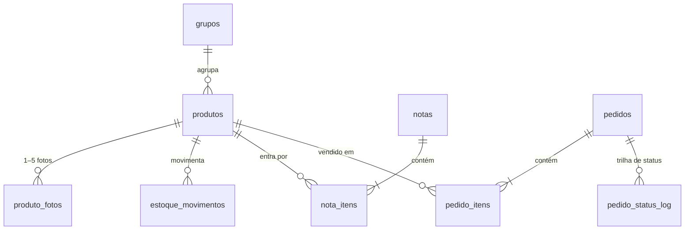

# Modelo de Dados

## Estrutura do `data.js` / payload da API

```js
window.CAST_STORE_DATA = {
  config: { storeName, tagline, orderEmail, emailSubjectPrefix, pickupLocations[],
    allowedDomains[], roles{admins[],gestores[],marketing[],compras[]},
    localUsers[{email,hash,grupo}], pickupEta, deliveryEta, storeUrl, castnetUrl,
    api{url}, campaignName, coupons[{code,type,value,scope,active}],
    auth{enabled,tenantId,clientId}, sharePoint{siteId,listId,stockListId} },
  notas: [{ id, numero, serie, dataEmissao,
    fornecedor{nome,cnpj,ie,contato,telefone,email,endereco},
    itens[{produto,total,inst,cpf,custo,dist[{unidade,destino,qtde}]}],
    registradaEm, registradaPor }],
  movimentos: [{ id, data, produto, tipo, destino, unidade, qtde, ref, por }],
  products: [{ id, name, group, variant, category, description, cost, price, promoPrice,
    sizes, ncm, imposto, impostoNf, isNew, featured, inCampaign, active, createdAt,
    images[1..5] }]
}
```

### Regras

- **Saldo** = soma dos `movimentos` (por destino/unidade).
- **Custo de referência** = média ponderada dos custos das `notas`.
- `sizes` vazio significa N/A.

## Tabelas MySQL (`cast_store`)

| Tabela | Conteúdo |
|---|---|
| `produtos` | Catálogo (código PK, nome, grupo, variação, categoria, preços, tamanhos, NCM, imposto, selos, ativo) |
| `produto_fotos` | 1–5 fotos por produto (ordem + imagem) |
| `grupos` | Grupos de variação |
| `estoque_movimentos` | Movimentações com tipo, **destino (institucional/cpf)**, **unidade**, quantidade ±, referências |
| `notas` / `nota_itens` | NF de compra com fornecedor completo; itens com total/inst/cpf/custo e rateio (`dist_json`) |
| `pedidos` / `pedido_itens` / `pedido_status_log` | Pedidos completos (tipo, solicitante, CC/IC/CV, recebimento, cupom, totais), itens com preço congelado e trilha de status |
| `cupons`, `campanhas` | Promoções |
| `configuracoes` | Chave/valor; `config_json` = config completo publicado pelo painel |

### Views

| View | Conteúdo |
|---|---|
| `v_estoque` | Saldo por produto |
| `v_estoque_destino` | Saldo por destino/unidade |

## Relacionamentos principais


