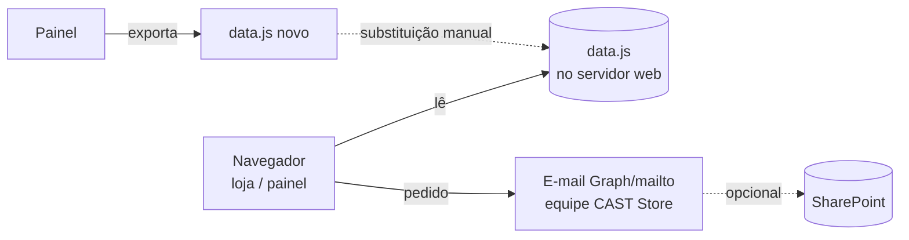
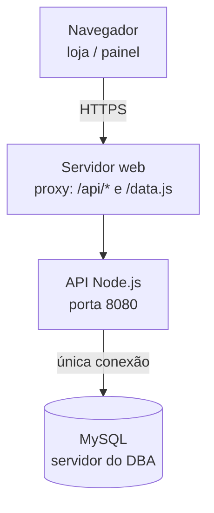

# Visão Geral da Arquitetura

A CAST Store evoluiu em duas fases. O frontend é o mesmo nas duas — muda apenas de onde
vêm os dados e para onde vão as publicações.

## Modo arquivo (fase 1 — sem banco)

## Modo banco (fase 2 — atual)

- A loja continua carregando `data.js`; o proxy entrega `GET /api/data.js`, montado do
  MySQL em tempo real, com a mesma estrutura `window.CAST_STORE_DATA`.
- O painel publica pelo botão **"Publicar no banco"**: o estado inteiro vai à API, que
  grava em transação. Pacotes maiores que ~700 KB são **fatiados** em partes para passar
  por proxies com limite de corpo de 1 MB.
- **A conexão com o MySQL é exclusiva da API** (credenciais no `.env` do servidor);
  o navegador nunca acessa o banco.

## Comparativo

| Aspecto | Modo arquivo (fase 1) | Modo banco (fase 2) |
|---|---|---|
| Fonte dos dados | `data.js` estático | MySQL via `GET /api/data.js` |
| Publicação | Baixar `data.js` e substituir no servidor | Botão **Publicar no banco** (transação) |
| Estoque online | Lista SharePoint (opcional) | MySQL com atomicidade real |
| Papel atual | Plano B | Fluxo oficial |

Veja também: [Modelo de Dados](modelo-de-dados.md), [Endpoints da API](../referencias/endpoints.md)
e [Instalação e Implantação](../operacao/instalacao.md).
