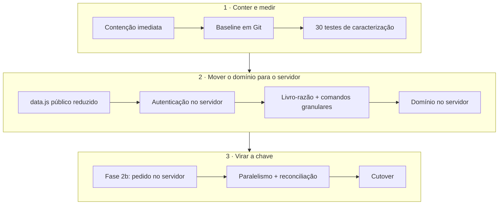

# Assessment v29 — Resumo Executivo

> **Escopo:** backup `cast-store-backup-v29` (código completo, SQL, guias e histórico v1→v29),
> documentação oficial e protótipo V30. Análise estática em **09/10/2026**, sem acesso ao
> servidor, ao banco ou ao `.env` de produção.

## Situação atual

1. Existe uma única versão (v29). Não há Git, testes, CI nem lockfile.
2. Loja e painel são **HTML/CSS/JS puro** e concentram **toda a regra de negócio no navegador**
   (preço, cupom, saldo, custo médio, ABC, permissões).
3. O backend é uma **API Node/Express + MySQL** fina: 7 rotas em um arquivo de 351 linhas.
4. O contrato entre as partes é o `window.CAST_STORE_DATA`, servido como `data.js` **público**,
   com config administrativo, perfis, hashes de senha, cupons, notas com dados de fornecedores
   e movimentações.
5. O painel trabalha num **rascunho em `localStorage`** e publica o **estado inteiro**: a API
   apaga e regrava notas e movimentações a cada publicação.
6. **Permissões só no cliente**; sem O365 e sem usuários locais, o painel abre como **administrador**.
7. Os pedidos saem por **mailto + PDF** (O365/SharePoint prontos, mas desligados): **não ficam
   registrados no banco e não baixam estoque**.
8. `POST /api/pedidos` (baixa atômica por destino) existe, mas **não é chamado** — e está exposto
   sem autenticação, confiando nos preços enviados pelo cliente.
9. As regras de negócio são ricas e coerentes: **103 regras** identificadas com ID, a maioria ✅ implementada.
10. A documentação tem **19 divergências** com o código (lista no fim desta página).

## Stack confirmada

| Camada | Tecnologia |
|---|---|
| Navegador | HTML/JS puro · MSAL 2.38.1 · jsPDF 2.5.1 · qrcodejs 1.0.0 (CDN) |
| Proxy | Servidor web: `/api`, `/data.js` |
| API | Node 20 · Express 4 · mysql2 3 |
| Banco | MySQL 8 (InnoDB) |
| Integrações | ViaCEP (ativa) · Entra ID, Graph e SharePoint (código pronto, **desativado**) |

Confiança **Alta** no comportamento do código; **Baixa** quanto à topologia real de produção.

## Riscos prioritários

| # | ID | Risco | Severidade |
|---|---|---|---|
| 1 | SEC-01 | `data.js` público expõe perfis, hashes de senha, cupons, custos e fornecedores | 🔴 Crítico |
| 2 | SEC-02 | Autorização só no navegador; painel abre como admin sem configuração | 🔴 Crítico ❓ (depende do servidor) |
| 3 | DAT-01 | Publicação por substituição total a partir de rascunho local: last-writer-wins; apagaria as saídas de pedidos na fase 2b | 🔴 Crítico |
| 4 | SEC-03/04 | Rotas de pedido sem autenticação, preço vindo do cliente, chave de API única guardada no navegador | 🟠 Alto |
| 5 | DAT-04 | Pedidos não baixam estoque → saldo exibido superestimado | 🟠 Alto |

## Decisões arquiteturais necessárias

1. **Stack corporativa-alvo** do backend e do painel.
2. **Identidade:** Entra ID validado na API; aposentar usuários locais e a chave estática.
3. **Fonte da verdade de pedidos e estoque:** MySQL (recomendado) × SharePoint.
4. **Substituir o "publicar tudo"** por comandos granulares com controle de concorrência.
5. **Fotos fora do JSON/banco** e `data.js` público reduzido.

## Quick wins (dias, sem mudar regra de negócio)

- Restringir `admin.html` e `/api/pedidos` no proxy.
- `CORS_ORIGIN` obrigatório; rotacionar a `API_KEY`.
- `try/catch` e supervisor na API (um PATCH inválido ou o banco fora do ar derrubam o processo).
- Lockfile e `npm ci`; versão do rodapé gerada no deploy.
- SRI e cabeçalhos de segurança; atualizar o `LEIA-ME`.

## Bloqueadores

- **Fase 2b** bloqueada por DAT-01 (a publicação apagaria as saídas) e SEC-03 (rotas sem autenticação).
- Stack corporativa não definida.
- Faltam informações de produção: proteção do `admin.html`, grant vigente, quem tem a chave,
  configuração publicada.

## Estratégia recomendada

**Strangler incremental**, não reescrita. A vitrine é preservada visualmente durante todo o processo.

O andamento está em [Backend FastAPI](backend-fastapi.md).

## Divergências a validar

Itens para validar com Rafael / equipe funcional:

| ID | Tema |
|---|---|
| DIV-01 | Como as vendas são lançadas hoje no estoque |
| DIV-02 | Bloquear o placeholder contando como foto |
| DIV-03 | "Margem" do painel é, na prática, **markup** |
| DIV-04 | Avarias entram como consumo na curva ABC |
| DIV-10 | Sigilo de custos para o Marketing |
| DIV-13 | Campos obrigatórios do fornecedor |
| DIV-17 | Reserva de estoque prevista no protótipo V30 |
| DIV-18 | Estorno de estoque no cancelamento |
| — | Se o SharePoint ainda é desejado; limites e aprovação de gestor |
