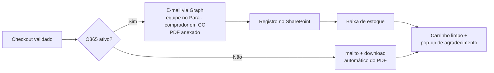

# A Loja (`index.html`)

> **Documento da v29 (histórico).** Quando houver conflito, valem as [Regras de Negócio v1](regras-de-negocio.md) (23/10/2026):
> toda compra exige login Entra ID (RN-04/05), o estoque institucional passa a ser o da operação por CAST Coins (RN-01, divergência DV-01)
> e a baixa ocorre só na confirmação (RN-03). O envio sem login (mailto + PDF) e o pedido institucional com CC/IC/CV ficam como histórico.

A loja é a parte pública do portal: vitrine, página do produto, carrinho, checkout e
"Meus pedidos", tudo em um único arquivo com JavaScript embutido.

## Vitrine

- Ordenação: **destaques (🔥)** → **novidades (✨)** → mais vistos (contagem local do navegador).
- Selos sobre a foto: `🔻 -X% Promoção`, `🎉 <campanha>`, `✨ Novidade`, `Esgotado`,
  `Últimas unidades` (≤5), `🔥 Mais pedido`.
- Busca por nome, descrição, código e variação; filtros por categoria e por campanha ativa.
- Card de grupo: variações agrupadas exibem bolinhas nas cores reais e faixa de preço.

## Página do produto

- Modal amplo com **altura fixa** (o frame da foto nunca muda entre variações).
- Galeria de 1–5 fotos com setas ‹ ›, contador (1/5), pontos de navegação e **zoom**
  em tela cheia (amplia 2,4× no ponto do clique; navegação por ← →).
- Seletor de variações: cada cor é um produto próprio (código/fotos/preço/estoque);
  o chip mostra a cor real (dicionário de ~40 cores em português).
- Seletor de tamanhos (quando cadastrados) e controle de quantidade limitado ao estoque.
- "Você também pode gostar": até 3 similares da mesma categoria.

## Carrinho e checkout (tela cheia)

- Itens com foto, código, opção, preço unitário, quantidade (o "−" em 1 remove o item),
  subtotal e remoção; botão **Limpar carrinho** (com confirmação); resumo com total.

### Tipo de pedido

| Tipo | Uso | Dados exigidos | Pagamento |
|---|---|---|---|
| 💙 **Social** (padrão) | Pedidos de colaboradores; parte da renda vai para ações sociais (link CASTNet configurável) | Dados do solicitante | **PIX** |
| 🏢 **Institucional** | Pedidos da empresa | Centro de Custo (CC), Item de Conta (IC), Classe de Valor (CV) e cliente/ação interna | Faturamento interno |

### Solicitante e recebimento

- Solicitante: nome e e-mail (pré-preenchidos e travados com login O365), **telefone
  obrigatório**, área. E-mail validado contra os domínios corporativos da CAST
  (lista configurável; a mensagem ao usuário não exemplifica domínios).
- Recebimento: **retirada** em unidade CAST (SP, Brasília, Araraquara, Curitiba) ou
  **entrega em casa** com CEP (busca automática ViaCEP, campos editáveis). Prazos
  estimados configuráveis por modalidade.
- **Cupom de desconto** com validação (% ou R$; produto específico ou compra inteira).
- Nº de pedido único `PED-AAAAMMDD-XXXX` no checkout, e-mail, PDF e registros.

### Envio do pedido

> **Como está em produção (assessment de 09/10/2026):** as integrações O365/SharePoint estão
> **desligadas**, então os pedidos seguem o caminho *mailto + PDF*. Eles **não são registrados no
> banco e não baixam estoque** — o saldo exibido na vitrine fica superestimado (DAT-04). O
> `POST /api/pedidos` com baixa atômica existe, mas ainda não é chamado (fase 2b).

O pop-up de agradecimento mostra os próximos passos: validação do pedido, alinhamento do
PIX (quando social) e entrega.

- Validações em pop-up central: lista tudo que falta e foca o primeiro campo pendente.

## Meus pedidos

Histórico dos pedidos do navegador com número, data, total e **status atualizado pela
equipe** (via SharePoint/banco), detalhes expandíveis e re-download do PDF.
