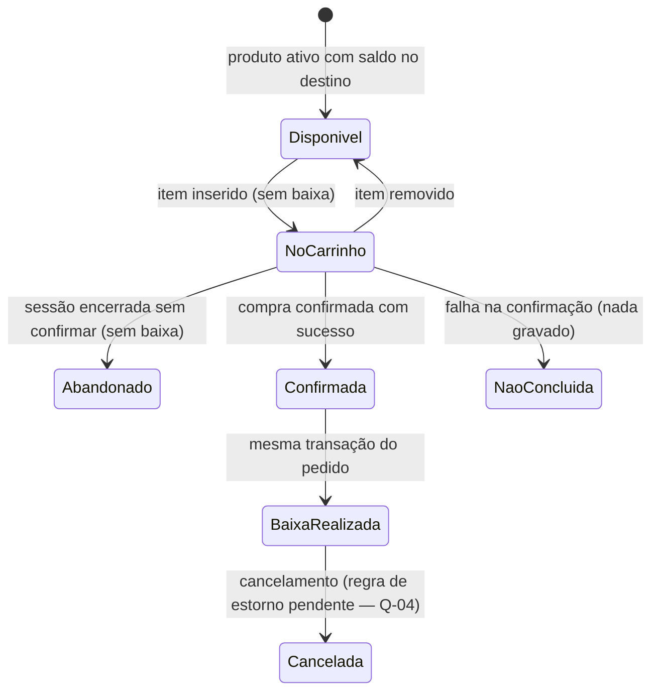

# Regras de negócio — CAST Store v1 (estoque, compra, identidade, perfis e CAST Coins)

| Metadado | Valor |
|---|---|
| Versão | 1.0 — **rascunho para revisão** |
| Data | 2026-10-23 |
| Origem | Instrução de produto da dona técnica do projeto (23/10/2026, RN-01 a RN-09) · reunião "Cast Store \| Review" (22/10/2026) · ADR-010, ADR-011, ADR-012, ADR-014 · documentação oficial v29 |
| Substitui | Nada é apagado. As afirmações da v29 que conflitam estão na seção "Afirmações substituídas" |
| Escopo | Regras de **produto**. Não descreve implementação; o estado de cada regra no código está na coluna "Situação" |

Legenda de situação: **Implementado** (código existe; pode estar atrás de flag desligada) ·
**Documentado** (regra definida, sem código) · **Pendente** (depende de decisão — ver Q-xx).
Nenhuma regra marcada como "Documentado" deve ser lida como pronta.

## RN-01 — Separação dos tipos de estoque

- A loja tem, no mínimo, dois destinos de estoque:
  1. **PIX/CPF** — estoque destinado à venda paga por PIX (destino `cpf` no banco);
  2. **Institucional** — estoque destinado à operação por **CAST Coins/pontos** (destino `institucional`).
- Uma mesma nota fiscal pode ter itens para os dois destinos. Ex.: nota com 5 itens, 3 para PIX/CPF e 2 para institucional.
- A entrada registra o **destino de cada item ou quantidade**. Não se presume destino único por nota.

| Aspecto | Situação |
|---|---|
| Destino por item de nota (total = institucional + CPF) e rateio por unidade | **Implementado** na v29 (painel) e no `POST /admin/purchase-invoices` da FastAPI (escrita desligada) |
| Institucional como estoque da operação por moedas | **Documentado** (ver divergência DV-01) |

## RN-02 — Segregação de todo o ciclo operacional

A separação PIX/CPF × institucional vale para: entradas, posição de estoque, movimentações,
baixas, vendas/pedidos, cobranças, relatórios, auditoria e histórico. **Nunca consolidar
silenciosamente os dois estoques** (um total só aparece ao lado das parcelas, nunca no lugar delas).

| Aspecto | Situação |
|---|---|
| `estoque_movimentos.destino`, views `v_estoque_destino`, relatórios por destino | **Implementado** |
| Baixa do pedido no destino correspondente | **Implementado** (ADR-010, desligado) |
| Cobrança e relatórios por meio de pagamento (PIX × moedas) | **Documentado** (ADR-011/ADR-012, propostas) |

## RN-03 — Momento da baixa

Adicionar ao carrinho **não** reduz o estoque. A baixa ocorre **somente na confirmação da compra com sucesso**.

| Estado | Efeito no estoque | Situação |
|---|---|---|
| Produto disponível | — | Implementado (catálogo) |
| Item no carrinho | nenhum | Implementado (carrinho no navegador; FE-005) |
| Carrinho abandonado | nenhum | Implementado por omissão (nada é gravado); **sem registro** do abandono |
| Compra confirmada + baixa | saída no destino, na mesma transação do pedido | Implementado (ADR-010), **desligado** (`ORDERS_ENABLED=false`) |
| Compra não concluída | nada gravado (rollback total) | Implementado (ADR-010) |
| Cancelada | estorno de estoque | Código da S4 existe, **desligado**; regras pendentes (Q-04) |

**Reserva temporária durante o checkout não está definida** → requisito pendente Q-03. O
protótipo V30 sugere reserva (DIV-17 do assessment); isso não é regra.

## RN-04 — Identificação do comprador

Toda compra é vinculada ao usuário autenticado no **Microsoft Entra ID**. Registrar no mínimo:

| Dado | Fonte | Situação |
|---|---|---|
| Identificador corporativo estável | claim `oid` do token (chave imutável) | **Lacuna**: o código atual grava e filtra o pedido pelo **e-mail do token** (`email`, `criado_por`); o `oid` só aparece na auditoria da S4 → Q-12 |
| Identificação exibida | nome/e-mail **do token**, nunca do corpo da requisição | Implementado (ADR-010) |
| Pedido, itens, tipo de operação, data/hora (UTC) | `pedidos`, `pedido_itens` | Implementado (desligado) |
| Movimentações de estoque e de moedas do pedido | `estoque_movimentos.pedido_id`; `moeda_lancamentos` | Estoque implementado; moedas **Documentado** (ADR-011) |

Nota: nome e e-mail **não** são chave imutável. A ADR-011 usa o e-mail como chave de negócio
para crédito (o Marketing não tem OIDs) e vincula o `entra_oid` no primeiro login; a leitura do
próprio extrato é sempre pelo OID do token. O pedido implementado (ADR-010, desligado) ainda usa o
e-mail do token como vínculo; adequar à RN-04 é a pendência técnica Q-12.

## RN-05 — Autenticação

O piloto precisa identificar quem compra: **a autenticação faz parte do fluxo de compra e não é opcional.**

- Login corporativo via **Microsoft Entra ID**.
- Frontend SPA com **Authorization Code + PKCE** (sem implicit grant, sem segredo no front).
- API valida o **access token** (assinatura JWKS, emissor, audiência, validade, tenant).
- Autorização sempre decidida **no backend**; o front só esconde.
- Usuário **sem role administrativa = colaborador comum**.
- **Login local e usuário/senha não fazem parte do fluxo-alvo** (os "usuários locais" da v29 ficam obsoletos).

Situação: **Implementado** no código (backend Fase 4; frontend `feat/fase4-entra-id` com
`VITE_AUTH_ENABLED`, padrão `false`). **Login real ainda não validado** com o tenant.

## RN-06 — Perfis

| Role | Escopo | Painel |
|---|---|---|
| `Store.Admin` | Acesso administrativo total | Sim |
| `Store.Manager` | Áreas funcionais e relatórios, **exceto configurações** | Sim |
| `Store.Marketing` | Catálogo comercial, conteúdo, preço, promoção, campanha e operação manual de moedas, conforme autorização | Sim |
| `Store.Purchasing` | Entradas, notas, produtos, estoque, cupons e relatórios | Sim |
| (sem role) | Colaborador comum: vitrine, carrinho, próprios pedidos e próprio saldo | Não |

- Os grupos **Admin, Manager, Marketing e Purchasing já foram criados** no Entra ID (informação de 23/10/2026).
- A relação definitiva de membros dos grupos **não administrativos** (Manager, Marketing, Purchasing) **continua pendente** (Q-01). Nenhum membro é registrado neste repositório.
- Possível separação futura entre Compras e Facilities: Q-02 (I1 da reunião de 22/10).
- Detalhe por capacidade: `docs/security/matriz-permissoes.md`. Modelo grupo → role: ADR-014 (Proposta).

## RN-07 — CAST Coins

- Cada colaborador tem **saldo individual**.
- Operação inicial **manual**: pessoa autorizada do Marketing registra **créditos ou ajustes**.
- **Não existe** integração automática nem job confirmado para concessão.
- Toda alteração registra: **usuário afetado, quantidade, motivo, operador e data/hora**.
- O colaborador consulta o **próprio** saldo.
- Compra por moedas **debita o saldo somente na confirmação** (mesma regra de momento da RN-03).
- **Não são regras definitivas** (pendentes Q-05, Q-06): emissão (regras de concessão), expiração,
  estorno/correção, conversão monetária, aprovação de ajustes.

Situação: **Documentado** (ADR-011, Proposto). Nenhuma tabela ou rota de moedas existe. Ver divergência DV-02.

## RN-08 — Histórico do colaborador

O colaborador autenticado consulta: histórico dos **próprios** pedidos, itens, situação,
forma da operação (PIX/CPF ou moedas) e movimentação de moedas relacionada.
**Não pode** ver histórico ou saldo de outras pessoas (recurso de outro dono → 404).

Situação: "meus pedidos" **Implementado** (`GET /api/v1/me/orders`, desligado com `ORDERS_ENABLED`);
forma da operação por moedas e extrato de moedas **Documentado**.

## RN-09 — Identidade visual

A vitrine vista pelo colaborador **já foi homologada e não será redesenhada**. Propostas de UX/UI
só para: painel administrativo, carrinho, estados de autenticação, mensagens de erro e
confirmação e novas áreas administrativas — reutilizando componentes, cores, tipografia e
identidade aprovados (FE-002).

## Divergências registradas (legado × decisão posterior)

| ID | Afirmação anterior | Fonte anterior | Decisão posterior | Tratamento |
|---|---|---|---|---|
| DV-01 | "Institucional" = pedido da empresa com CC, IC, CV e cliente/ação, pago por **faturamento interno** | Doc. oficial v29 §6.3; ADR-010 (institucional exige CC/IC/CV) | RN-01: institucional = estoque da operação por **CAST Coins/pontos** | A anterior fica como **histórico**. Se o pedido institucional com CC/IC/CV continua existindo e de qual estoque sai → **Q-13**. A reunião de 22/10 tratava isso como incerto (I2) |
| DV-02 | Ajuste de saldo **só `Store.Admin`**; Marketing credita/estorna | ADR-011; matriz §2 (proposta) | RN-07: Marketing registra **créditos ou ajustes**; reunião 22/10 (D7): **grupo próprio** para ajustes | Matriz **não alterada**; quem ajusta e se precisa aprovação → **Q-06** |
| DV-03 | Login do painel por usuários locais (e-mail + senha SHA-256) ou O365 opcional | Doc. oficial v29 §5 | RN-05: só Entra ID; login local fora do fluxo-alvo | v29 marcada como obsoleta neste ponto |
| DV-04 | "Grupos com membros a confirmar"; "TI cria grupos quando receber os nomes" | `entra-id-registro.md`; reunião 22/10 (D5) | RN-06: grupos Admin/Manager/Marketing/Purchasing **criados**; membros não-admin pendentes | Registros atualizados |
| DV-05 | Pedido pode sair sem login (mailto + PDF) | Doc. oficial v29 §6.3 | RN-04/RN-05: toda compra vinculada ao usuário Entra ID | v29 obsoleta neste ponto |
| DV-06 | Piloto "só navegação com login desligado" | backlog (20/10) | Reunião 22/10 (D1) + RN-05 | Já atualizado em 22/10 |

## Questões em aberto (não são regras)

| # | Questão | Responsável sugerido |
|---|---|---|
| Q-01 | Responsáveis e membros definitivos de Manager, Marketing e Purchasing | Negócio (indica) · TI (cadastra) |
| Q-02 | Separação futura entre Compras e Facilities (role nova × `Store.Manager`) | Negócio · TI |
| Q-03 | Reserva concorrente de estoque durante o checkout (existe? por quanto tempo?) | Negócio · Desenvolvimento |
| Q-04 | Cancelamento, estorno e devolução (transições, quem pode, estorno automático) | Negócio |
| Q-05 | Expiração e correção de CAST Coins | Negócio (Marketing) |
| Q-06 | Aprovação de ajustes de saldo (quem ajusta; quatro olhos?) | Negócio (Marketing) |
| Q-07 | Origem e carga oficial de produtos e fotografias | Negócio (envia a lista) · Desenvolvimento (script no DSV) |
| Q-08 | Formato definitivo da cobrança por PIX | Negócio · Financeiro |
| Q-09 | Regras fiscais e contábeis por tipo de estoque | Financeiro/Contábil |
| Q-10 | URL, TLS, portas e redirect URI do ambiente publicado | TI/Infra · Segurança |
| Q-11 | Critérios de segurança para liberar o piloto | Segurança |
| Q-12 | Gravar o `oid` do comprador no pedido e usá-lo em "meus pedidos" (hoje: e-mail do token em `app/orders/service.py`). Exige coluna nova → DBA/Alembic | Desenvolvimento · DBA |
| Q-13 | Pedido institucional com CC/IC/CV continua existindo após RN-01? Se sim, de qual estoque sai? | Negócio |
