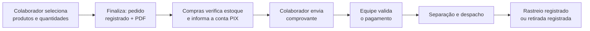

# Regras de negócio — CAST Store v1 (MVP, estoque, pedido, perfis e CAST Coins)

| Metadado | Valor |
|---|---|
| Versão | **1.1 — rascunho para revisão** (v1.0 de 23/10/2026 substituída; diferenças em "Histórico desta página") |
| Data | 2026-10-29 |
| Origem | **Reunião de alinhamento do MVP com o gestor** (`docs/reunioes/alinhamento-mvp-gestor.md`; data exata da reunião não registrada nas anotações) · instrução de produto de 23/10/2026 · reunião "Cast Store \| Review" de 22/10/2026 · ADR-010, ADR-011, ADR-012, ADR-014 · documentação oficial v29 |
| Precedência | Quando conflitar, vale a fonte **mais recente**. As afirmações substituídas ficam em "Divergências" |
| Escopo | Regras de **produto**. A coluna "Situação" diz o que existe no código; "Documentado" não significa pronto |

Legenda: **Implementado** (código existe; pode estar atrás de flag desligada) · **Documentado** (regra definida,
sem código) · **Pendente** (depende de decisão — ver Q-xx). Status de cada regra: **Decidido** ou **A validar**.

## RN-00 — Escopo do MVP (primeira versão vendável) — Decidido

Prioridade do gestor: colocar a operação de venda no ar o quanto antes (prazo citado como "na mesma semana da
reunião"; sem data registrada). O MVP inclui:

| Item do MVP | Situação no código (29/10/2026) |
|---|---|
| Visualizar produtos (vitrine) | **Implementado** (React + catálogo FastAPI; homologação no ar só via VPN) |
| Cadastrar e editar produtos (descrição, fotos, cores, variações) | Rotas de escrita **implementadas e desligadas** (`ADMIN_WRITE_ENABLED=false`); telas do painel em construção (fatias) |
| Registrar entrada de notas | Rota implementada e **desligada**; tela pendente |
| Separar estoque institucional × CPF | **Implementado** no modelo de dados (destino por movimento) |
| Controlar estoque por unidade | Modelo tem `unidade` nas entradas; baixa do pedido grava unidade NULL (ADR-010) → **lacuna** |
| Pedido por PIX (manual) | Pedido FastAPI implementado e **desligado** (`ORDERS_ENABLED=false`); fluxo manual de PIX **Documentado** |
| Pedido institucional por centro de custo | Implementado na regra do pedido (CC/IC/CV) e **desligado**; finalidade **não existe** no código |
| Registro do pedido | Implementado (desligado) |
| PDF do pedido para download | **Não existe** na nova aplicação (existia na v29 via jsPDF) → lacuna |
| Área administrativa para autorizados | Rotas protegidas por App Roles implementadas; **Entra ID desligado** na homologação |

Fora do MVP: CAST Coins definitivo (RN-07) e as automações da seção "Adiado".

## RN-01 — Dois tipos de estoque e entrada por nota — Decidido

- Destinos: **CPF** (venda ao colaborador, paga por PIX; destino `cpf`) e **institucional** (uso da empresa, por
  **centro de custo**; destino `institucional`).
- Uma nota pode ter itens e quantidades para os dois destinos.
- A entrada registra, por item: produto, **quantidade total recebida**, **custo unitário**, **unidade/local do
  estoque**, quantidade para **CPF** e quantidade **institucional**.
- **Validação:** o sistema impede `quantidade CPF + quantidade institucional > quantidade recebida`. Feedback visual:
  vermelho enquanto inconsistente, verde quando válido. (Ver DV-07 sobre "igual" × "menor ou igual".)
- Exemplo da reunião: 10 cadernos, custo R$ 17,50, 5 para CPF e 5 institucionais.

Situação: entrada com total = institucional + CPF e rateio por unidade **Implementado** na v29 e na rota FastAPI
(desligada). A hipótese de defeito de estado no JavaScript do formulário é **hipótese técnica**, não diagnóstico.

## RN-02 — Segregação em todo o ciclo e chave de estoque — Decidido

- O estoque é controlado pela combinação **produto + variação + unidade física + finalidade (CPF/institucional)**.
  Unidades citadas: São Paulo e Brasília (lista completa nas configurações da loja).
- A separação vale para entradas, posição, movimentações, baixas, pedidos, cobranças, relatórios, auditoria e
  histórico. **Nunca consolidar silenciosamente** os dois destinos.
- Justificativa do negócio: separar origem e destino das verbas, campanhas, centros de custo, vendas comerciais,
  custos institucionais e relatórios financeiros.

Situação: destino e unidade existem em `estoque_movimentos`; a baixa do pedido ainda não grava unidade → **Q-15**.

## RN-03 — Momento da baixa — **A validar**

- Adicionar ao carrinho **não** reduz estoque (decidido em 23/10; consistente com a v29).
- O **momento exato da baixa** voltou a ser questão aberta (**Q-03b**): no fluxo do MVP, o pedido é gerado e
  depois Compras verifica estoque, orienta o PIX e valida o comprovante; o institucional passa por validação
  **antes do débito**. A baixa pode ocorrer na geração do pedido, na validação do pagamento/débito ou na separação.
- Reserva concorrente durante o checkout: continua **Q-03**.

O pedido FastAPI implementado (ADR-010) baixa **na criação do pedido**. Não ativar antes de decidir Q-03b.

## RN-04 — Identificação do comprador — Decidido (23/10)

Toda compra vinculada ao usuário autenticado no Entra ID, com identificador estável (`oid`), identificação
exibida, pedido, itens, tipo de operação, data/hora e movimentações relacionadas.
**Lacuna:** o pedido implementado grava e filtra pelo **e-mail do token** → **Q-12**.

## RN-05 — Autenticação — Decidido (23/10)

Entra ID com SPA (Authorization Code + PKCE), API valida o access token, autorização no backend, sem role =
colaborador comum, sem login local. A reunião do MVP acrescenta: acesso administrativo pelo usuário autenticado
**e** por uma flag/permissão administrativa. Situação: código pronto; **desligado** na homologação
(`VITE_AUTH_ENABLED=false`, Entra ID não configurado) → o MVP depende de ativar (redirect URI HTTPS).

## RN-06 — Perfis e funções — **A validar** (direção definida pelo gestor)

| Função (reunião do MVP) | Responsabilidades | Não pode | Role atual mais próxima |
|---|---|---|---|
| **Gestão CAST Store** (Compras e Facilities) | Entrada de notas, estoque, custos, preços, produtos, operações da loja, validação de pagamento, separação, despacho | — | `Store.Purchasing` (+ `Store.Manager`?) |
| **Gestão CAST Coins** | Administrar saldos de moedas | — | **nenhuma** (role nova a definir) |
| **Marketing** | Fotos, descrições, conteúdo comercial; **adicionar** moedas | **Custo, preço, estoque, regras financeiras** | `Store.Marketing` |
| **TI** | **Remover** moedas, suporte a acessos, controles técnicos, trilha de operações | — | `Store.Admin` |
| Sem role | Colaborador comum | Painel | — |

- Acesso administrativo inicial: **três pessoas** (dona técnica, gestor e um terceiro validador), a validar no
  Entra ID. Nomes não são registrados no repositório.
- Grupos Admin, Manager, Marketing e Purchasing já criados (23/10). A reunião pede separar **Marketing, Cash Store,
  Cash Coin e TI** → mapeamento final em **Q-02/Q-16**.
- **Divergência DV-08:** em 23/10 o Marketing tinha "preço, promoção e campanha"; agora **não altera preço**. A
  matriz implementada ainda dá `catalog.read` e preços/campanhas ao Marketing → **não alterada** até Q-16.

## RN-07 — CAST Coins — **NO-GO para regra financeira definitiva**

Decidido (direção):
- Saldo individual; operação manual; **Marketing adiciona** moedas; **TI remove** saldo.
- Moedas valem **somente para compras por CPF**. Pedido **institucional não usa moedas**.
- Uso previsto: pagar integralmente, abater parte ou **combinar com pagamento financeiro** (misto).
- Todo lançamento registra usuário afetado, quantidade, motivo, operador e data/hora; colaborador vê só o próprio saldo.
- Débito só na confirmação da compra (momento exato acompanha Q-03b).

A validar com o gestor (**Q-05, Q-06, Q-17**): equivalência moeda × real (R$ 0,05? R$ 0,10? outra); conversão
única ou por produto; produtos elegíveis; efeito de campanhas na conversão; regra exata do pagamento misto
(ex.: pedido de 1.050 moedas com saldo de 1.000 e diferença em dinheiro); expiração; correção; aprovação.

A estrutura (livro-razão, ADR-011) pode ser preparada; **nenhum valor de conversão ou regra de pagamento misto
deve ser codificado como fixo**. Situação: **Documentado** (ADR-011 Proposto); nada implementado.

## RN-08 — Histórico do colaborador — Decidido (23/10)

Próprios pedidos, itens, situação, forma da operação e movimentação de moedas; nunca dados de outra pessoa.

## RN-09 — Identidade visual — Decidido

Vitrine homologada **não** será redesenhada. **Painel administrativo: autorização para reorganizar** (simplificar
navegação e reduzir esforço cognitivo), preservando identidade visual, conteúdos e funções previstos e sem remover
campos do protótipo. Referência para a revisão: **versão V26** indicada pelo gestor. Regras de negócio não mudam
por decisão de interface.

## RN-10 — Precificação — Decidido (estrutura) / A validar (valores)

- Margem **configurável globalmente e por produto**, considerando impostos, preço de mercado e estratégia.
- Margem inicial indicada: **25% sobre o custo** — **não é regra definitiva** (Q-18). Ex.: custo R$ 17,50 → preço
  calculado R$ 21,875; **arredondamento e preço final a definir** (Q-19).
- Produtos baratos podem ter margem maior; caros (ex.: mochilas) menor; o preço sugerido pode ser ajustado
  manualmente.
- Campos mínimos por produto: custo unitário, margem %, preço calculado, preço sugerido/final, ajuste manual e
  registro da separação venda × institucional.
- **Institucional não recebe margem comercial**: registra o custo do produto e o débito no centro de custo.
- A planilha de preços pode alimentar custo/margem/preço sugerido, mas **não é fonte definitiva** sem conferência
  com as notas fiscais e decisão comercial do gestor (Q-07/Q-20).

Situação: cálculo por produto **Implementado** no backend (`app/backoffice/rules.py`: preço = custo médio ×
(1 + margem/100), arredondado a centavos com *half up* — R$ 21,875 → R$ 21,88; escrita desligada). Esse
arredondamento é técnico e **não** substitui a decisão Q-19. Margem **global** configurável **não existe**.
A "margem" da v29 é, na prática, markup (DIV-03) — mesma fórmula.

## RN-11 — Usuários inativos — Decidido (comportamento) / A validar (mecanismo)

Quem sai da organização **não é excluído**: fica **inativo**, o saldo de moedas é **zerado** com registro da
operação, e o histórico é preservado. Em eventual retorno, o saldo anterior **não** volta automaticamente.
Mecanismo pendente (**Q-21**): detecção automática ou manual, sincronização com o Entra ID, quem aprova o
zeramento, desligamentos e reativações retroativas.

## RN-12 — Fluxo de pedido do MVP — Decidido (fluxo) / A validar (detalhes)

**Pedido CPF (PIX manual):**

- Sem QR Code e sem processamento automático de PIX; validação do comprovante **manual**; conta PIX informada
  pela equipe (formato definitivo: Q-08).
- Canal operacional inicial pode ser o Posso Ajudar ou um endereço da loja (Q-22).

**Pedido institucional:** identifica **centro de custo** e **finalidade** (ex.: brinde); passa por **validação
antes do débito**; sai do **estoque institucional**; sem moedas e sem margem. Dados obrigatórios do centro de custo
(a v29 exigia CC, IC, CV e cliente/ação): **Q-23**.

**Documentos:** registro do pedido, **PDF para download** e dados para um e-mail (envio automático pelo
Microsoft 365 é evolução).

**Entrega:** correio com código de rastreio, ou retirada na unidade com registro da entrega.

**Tipos de pedido:** se "pedido social" é um terceiro tipo ou a própria venda por CPF: **Q-24**.

## Adiado (backlog — não faz parte do MVP)

Confirmação de recebimento pelo solicitante (válida, não prioritária) · encerramento automático após a entrega ·
automação do despacho e orquestração da entrega · e-mail automático pelo Microsoft 365 · processamento automático
do PIX · QR Code PIX · regras definitivas do pagamento misto com moedas.

## Etapas de produto (gestor)

| Etapa | Conteúdo |
|---|---|
| 1 — Primeira versão vendável | Produtos e variações, fotos e descrições, entrada de notas, custo e margem, estoque CPF e institucional, controle por unidade, pedido PIX manual, pedido institucional com CC e finalidade, registro do pedido, PDF, acesso administrativo |
| 2 — Validação operacional | Acessos dos três validadores, quantidades, baixa de estoque, fluxos CPF e institucional, retirada e rastreio, correções do painel |
| 3 — CAST Coins | Conversão, elegíveis, pagamento parcial/integral/misto, grupos de gestão, adição/remoção, inativos, trilha |
| 4 — Automações | Confirmação de recebimento, encerramento automático, Microsoft 365, notificações, pagamento automático, QR Code, entrega |

Caminho crítico do MVP: produtos → entrada da nota → separação do estoque → preço → permissões → pedido PIX/CC →
PDF → validação operacional.

**Bloqueios técnicos para a Etapa 1** (estado de 28/10, ver `estado-ambientes.md` na infra): Entra ID desligado e
sem redirect URI HTTPS; `ADMIN_WRITE_ENABLED` e `ORDERS_ENABLED` desligados e com gates próprios (ADR-010, ADR-013:
publish do Node apaga movimentos); telas do painel e do checkout incompletas; PDF inexistente; HTTPS 8443 ainda
bloqueado na VPN; corte do legado não autorizado.

## Divergências registradas

| ID | Afirmação anterior | Fonte | Decisão posterior | Tratamento |
|---|---|---|---|---|
| DV-01 | Institucional = estoque da operação por **CAST Coins** | RN-01 v1.0 (23/10) | **Revertido** pela reunião do MVP: institucional = uso por centro de custo, **sem** moedas; moedas só no CPF | RN-01 v1.0 obsoleta; volta a valer a linha da v29/ADR-010 (CC); Q-13 respondida |
| DV-02 | Ajuste de saldo só Admin (ADR-011) / Marketing ajusta (23/10) / grupo próprio (22/10) | — | Marketing **adiciona**, TI **remove** | Matriz não alterada até Q-16 |
| DV-03 | Usuários locais | v29 §5 | Só Entra ID | Obsoleto |
| DV-04 | Grupos a criar | registro Entra ID | Grupos criados (23/10) | Atualizado |
| DV-05 | Pedido sem login | v29 §6.3 | Pedido vinculado ao usuário Entra ID | Obsoleto |
| DV-06 | Piloto só navegação | backlog 20/10 | Login no piloto (22/10) | Atualizado |
| DV-07 | Total recebido = institucional + CPF (exato) | v29 §7.1 | Impedir soma **maior** que o recebido | **A validar (Q-25):** sobra não destinada é permitida? |
| DV-08 | Marketing edita preço/promoção | RN-06 v1.0, matriz | Marketing **não** altera custo, preço, estoque ou regras financeiras | Q-16 |
| DV-09 | Baixa na confirmação da compra | RN-03 v1.0 | Momento exato da baixa em aberto no fluxo manual | Q-03b |

## Questões em aberto (não são regras)

| # | Questão | Responsável |
|---|---|---|
| Q-01 | Membros definitivos dos grupos não administrativos | Gestor · TI |
| Q-02 | Compras × Facilities como funções separadas | Gestor |
| Q-03 | Reserva concorrente de estoque no checkout | Gestor · Desenvolvimento |
| Q-03b | Momento exato da baixa (geração do pedido, validação do pagamento/débito ou separação) | Gestor |
| Q-04 | Cancelamento, estorno e devolução | Gestor |
| Q-05 | Expiração e correção de moedas | Gestor (Marketing) |
| Q-06 | Aprovação de ajustes/remoções de saldo | Gestor · TI |
| Q-07 | Origem e carga oficial de produtos e fotos | Gestor |
| Q-08 | Formato definitivo da cobrança PIX (conta, comprovante) | Gestor · Financeiro |
| Q-09 | Regras fiscais/contábeis por tipo de estoque | Financeiro/Contábil |
| Q-10 | URL, TLS, portas e redirect URI de produção | TI/Infra · Segurança |
| Q-11 | Critérios de segurança para liberar o piloto/corte | Segurança |
| Q-12 | Gravar `oid` no pedido | Desenvolvimento · DBA |
| Q-13 | ~~Pedido institucional com CC continua?~~ **Respondida**: sim, sem moedas, estoque institucional | — |
| Q-14 | ~~Facilities~~ incorporada em Q-02/Q-16 | — |
| Q-15 | Baixa do pedido por unidade física | Desenvolvimento · Gestor |
| Q-16 | Mapeamento final funções → roles (Gestão CAST Store, Gestão Coins, Marketing, TI) e permissões exatas Marketing × TI | Gestor · TI |
| Q-17 | Conversão moeda × real, elegíveis, campanhas, pagamento misto | Gestor |
| Q-18 | Margem global de 25% como padrão definitivo? | Gestor |
| Q-19 | Arredondamento e preço comercial final | Gestor |
| Q-20 | Planilha: carga inicial ou cadastro permanente? | Gestor |
| Q-21 | Mecanismo de inativação e zeramento (automático/manual, Entra ID, aprovador) | Gestor · TI |
| Q-22 | Fluxo operacional via Posso Ajudar ou endereço da loja | Gestor |
| Q-23 | Dados obrigatórios do centro de custo (CC, IC, CV, finalidade?) | Gestor |
| Q-24 | "Pedido social" é um terceiro tipo ou a venda por CPF? | Gestor |
| Q-25 | Entrada pode deixar quantidade sem destino (CPF + inst. < recebida)? | Gestor |
| Q-26 | Conteúdo e destinatários do futuro e-mail do pedido | Gestor |

## Histórico desta página

| Versão | Data | Mudança |
|---|---|---|
| 1.0 | 23/10/2026 | RN-01 a RN-09 a partir da instrução de produto |
| 1.1 | 29/10/2026 | Reunião do MVP: RN-00, RN-10, RN-11, RN-12; RN-01 revertida (DV-01); RN-03, RN-06 e RN-07 reabertas; Q-13 respondida; Q-15 a Q-26 |
