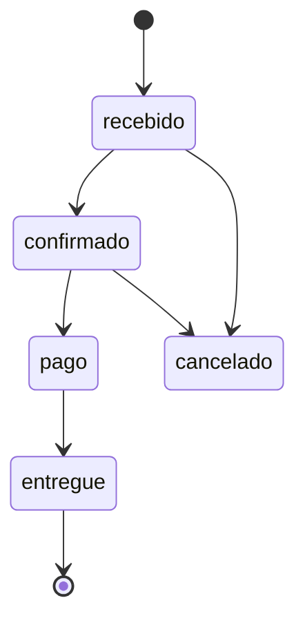

# Endpoints da API

Base: `http(s)://<servidor>:8080` (ou via proxy no servidor web).

| Método e rota | Autenticação | Função |
|---|---|---|
| `GET /api/health` | — | Status da API e conexão com o banco |
| `GET /api/data.js` (e `/data.js`) | — | data.js dinâmico montado do MySQL |
| `POST /api/admin/publish` | X-Api-Key | Grava o estado completo do painel (transação) |
| `POST /api/admin/publish-chunk` | X-Api-Key | Publicação em partes (~700 KB) para proxies limitados |
| `POST /api/pedidos` | — (fase 2b) | Registra pedido com **baixa atômica** por destino |
| `GET /api/pedidos?email=` | — (fase 2b) | Pedidos do colaborador (Meus pedidos) |
| `PATCH /api/pedidos/:numero` | X-Api-Key | Atualiza status (recebido/confirmado/pago/entregue/cancelado) |

> ⚠️ **Estado em produção (assessment v29):** as rotas de pedido estão **sem autenticação** e
> confiam no preço enviado pelo cliente (SEC-03); a `API_KEY` é única e fica no navegador do
> admin (SEC-04). O `POST /api/pedidos` ainda não é chamado pela loja.

## Novo backend (FastAPI · `/api/v1`)

| Método e rota | Função |
|---|---|
| `GET /health/live` · `GET /health/ready` | Liveness e readiness |
| `GET /api/v1/storefront/catalog` | Catálogo público, somente leitura |
| `GET /api/v1/storefront/photos/{id}` | Fotos por URL |
| `GET /data.js` | Adaptador público reduzido (desligado por padrão) |
| `GET /api/v1/admin/state` | Provisório, `X-Admin-Read-Key`, proibido em produção |

Detalhes em [Backend FastAPI](../modernizacao/backend-fastapi.md).

## Status de pedido



## Variáveis do `.env`

| Variável | Descrição |
|---|---|
| `PORT` | Porta da API (padrão 8080) |
| `DB_HOST` / `DB_PORT` | Servidor MySQL |
| `DB_NAME` | Banco (`cast_store`) |
| `DB_USER` / `DB_PASS` | Usuário da API (`caststore_api`) |
| `API_KEY` | Chave exigida no header `X-Api-Key` |
| `CORS_ORIGIN` | Origem permitida do frontend |

## Exemplo

```bash
curl -s https://<servidor>/api/health
```
